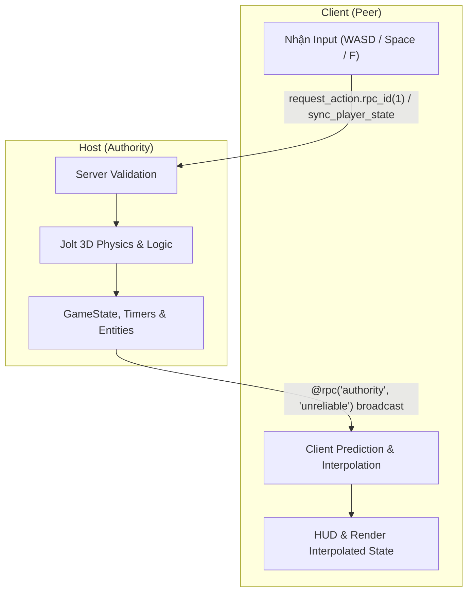

# 🎮 PanicParty

<div align="center">


<p align="center">
  <b>Hỗn loạn, kịch tính và vui nhộn!</b><br>
  Trò chơi minigame nhiều người chơi (Multiplayer Party Game) góc nhìn thứ 3 được xây dựng trên nền tảng <b>Godot 4.7</b>, kết hợp cùng <b>Jolt 3D Physics</b> và <b>Steamworks P2P Relay</b>.
</p>

[Tải Game Chơi Ngay](#-tải-game-chơi-ngay-dành-cho-người-chơi) •
[Tính Năng](#-tính-năng-nổi-bật) •
[Danh Sách Minigames](#-danh-sách-minigames) •
[Kiến Trúc & Mạng](#-kiến-trúc-hệ-thống--multiplayer) •
[Điều Khiển](#-bảng-điều-khiển) •
[Cài Đặt & Chạy](#-hướng-dẫn-cài-đặt--chạy-dự-án) •
[AI Development](#-phát-triển-cùng-ai-agents--graphify)

</div>

---

## 📥 Tải Game Chơi Ngay (Dành Cho Người Chơi)

Bạn không cần cài đặt Godot hay các công cụ lập trình, chỉ cần tải bản đóng gói sẵn:

1. **Tải bản cài đặt**: Truy cập [**GitHub Releases**](https://github.com/NVThang199/PanicPartyDev/releases) và tải file zip mới nhất (ví dụ: `PanicParty-v1.0.0-windows.zip`).
2. **Giải nén**: Giải nén file `.zip` vào một thư mục bất kỳ trên máy tính.
3. **Mở Steam**: Đảm bảo ứng dụng **Steam đang chạy ngầm** và đã đăng nhập tài khoản của bạn.
4. **Vào game**: Chạy file `PanicParty.exe`.

### 🎮 Cách Chơi Cùng Bạn Bè:
- **Người tạo phòng (Host)**: Bấm `Host Server` → Vào phòng chờ (Lobby) → Bấm nút `COPY MÃ PHÒNG` ở thanh menu dưới cùng để sao chép mã.
- **Người tham gia (Client)**: Khởi động game → Tại Menu chính, dán mã vào ô `Nhập mã phòng...` → Bấm nút `Vào`.
- *Không cần kết bạn Steam, hỗ trợ cả tài khoản Steam chưa nạp tiền (Limited Account).*

---

## 🌟 Giới Thiệu Game

**PanicParty** là tựa game tiệc tùng 3D (3D Party Game) nơi người chơi cạnh tranh qua hàng loạt màn chơi nhỏ (minigames) dồn dập. Mỗi vòng chơi thử thách phản xạ, độ khéo léo và khả năng phối hợp hoặc "chơi khăm" bạn bè. Người chơi tích lũy điểm số qua từng minigame để tìm ra nhà vô địch cuối cùng.

---

## ✨ Tính Năng Nổi Bật

- 🌐 **Steam P2P Relay Không Cần Port Forwarding**: Kết nối liền mạch qua Steam Lobby Code, hỗ trợ cả tài khoản Steam Limited (chưa nạp 5$), không yêu cầu kết bạn trước.
- ⚡ **Server-Authoritative Networking**: Mọi logic chuyển động, va chạm vật lý, tính giờ và sinh entity đều do Host quyết định, giảm thiểu tuyệt đối tình trạng desync hoặc gian lận.
- 🕹️ **Jolt 3D Physics Engine**: Mô phỏng vật lý chân thực, mượt mà và tối ưu hiệu năng vượt trội so với Godot Physics mặc định.
- 🔄 **Handshake & Safe Late-Join**: Cơ chế bắt tay RPC hai chiều đảm bảo các máy client vào sau hoặc load chậm không bị rớt gói tin spawn hay kẹt trạng thái.
- 🤖 **Universal AI Agent Instructions & Graphify**: Tích hợp Knowledge Graph và đồng bộ tự động quy tắc phát triển cho mọi AI assistant (Claude Code, Cursor, Windsurf, Copilot, Gemini, OpenCode, Codex).

---

## 🎲 Danh Sách Minigames

| Minigame | Trạng Thái | Mô Tả & Gameplay |
| :--- | :---: | :--- |
| **💣 Hot Bomb** | `Sẵn sàng` | Trái bom hẹn giờ sẽ bám đuổi người chơi! Người giữ bom phải áp sát và ném bom (`F`) sang đối thủ trước khi đếm ngược về 0 và phát nổ. |
| **🧱 Stable Footing** | `Sẵn sàng` | Sàn đấu gồm các khối gạch liên tục rung lắc và sụp đổ. Hãy di chuyển khéo léo để là người cuối cùng còn trụ lại trên sàn. |
| **🏁 Obstacle Rush** | `Kế hoạch` | Vượt chướng ngại vật hỗn loạn tính thời gian về đích. |

---

## 🏗️ Kiến Trúc Hệ Thống & Multiplayer



### Quy tắc Multiplayer cốt lõi:
1. **Server Authority**: Chỉ server (`multiplayer.is_server()`) mới chạy timer, trừ điểm, tính va chạm và quyết định loại người chơi.
2. **Client-Pull Handshake**: Khi Client load xong scene (`_ready()`), Client chủ động gọi `request_game_sync.rpc_id(1)` xin dữ liệu entity và state hiện tại từ Host.
3. **RPC Binding**: Mọi lệnh RPC mạng bắt buộc dùng cú pháp `.rpc(...)` hoặc `.rpc_id(...)`.
4. **4 Lớp bảo vệ RPC**: Mọi hàm nhận state đều kiểm tra `is_inside_tree()`, trạng thái kết nối `MultiplayerPeer.CONNECTION_CONNECTED`, `local_id`, và `is_instance_valid()`.

---

## 🎮 Bảng Điều Khiển

| Hành Động | Bàn Phím & Chuột | Tay Cầm (Xbox / PS) |
| :--- | :---: | :---: |
| **Di Chuyển** | <kbd>W</kbd> <kbd>A</kbd> <kbd>S</kbd> <kbd>D</kbd> / Phím Mũi Tên | Cần gạt trái (Left Stick) |
| **Nhảy** | <kbd>Space</kbd> | Nút <kbd>A</kbd> / <kbd>✕</kbd> |
| **Tương Tác / Ném Bom** | <kbd>F</kbd> | Nút <kbd>X</kbd> / <kbd>□</kbd> |
| **Xoay Camera** | Di chuột | Cần gạt phải (Right Stick) |

---

## 🚀 Hướng Dẫn Cài Đặt & Chạy Dự Án

### Yêu Cầu Môi Trường
- **Godot Engine**: Phiên bản **4.7.2** (hỗ trợ GDExtension / GodotSteam).
- **Steam Client**: Đang mở và đăng nhập ở chế độ nền (để khởi tạo Steam API AppID `480`).
- **Git** & **Python 3.10+** (dùng cho công cụ Graphify và git hooks).

### Các Bước Thực Hiện

1. **Clone repository**:
   ```bash
   git clone https://github.com/your-username/PanicPartyDev.git
   cd PanicPartyDev
   ```

2. **Kích hoạt Git Hooks tự động**:
   ```bash
   git config core.hooksPath .githooks
   ```

3. **Mở dự án trong Godot**:
   - Khởi chạy Godot Editor 4.7.2.
   - Nhấn **Import**, chọn file `project.godot` trong thư mục vừa clone.
   - Chờ Godot quét tài nguyên và shader cache.

4. **Kiểm tra Multiplayer nội bộ (2 Người Chơi)**:
   - **Cách 1**: Dùng tính năng *Debug > Run Multiple Instances (2 instances)* trong Godot Editor.
   - **Cách 2**: Export bản build Windows Desktop.
	 - **Máy 1 (Host)**: Bấm `Host Server` → Vào Lobby → Nhấn nút `COPY MÃ PHÒNG` dưới màn hình.
	 - **Máy 2 (Client)**: Tại Main Menu, dán mã phòng vào ô `Nhập mã phòng...` và nhấn `Vào`.

---

## 🤖 Phát Triển Cùng AI Agents & Graphify

Dự án áp dụng quy chuẩn **Single Source of Truth** cho quy tắc phát triển:

- File gốc duy nhất: `CLAUDE.md`.
- Khi `CLAUDE.md` được cập nhật, script `update_graph.py` (thông qua Pre-commit hook và Claude Code hook) sẽ tự động đồng bộ sang tất cả định dạng của các AI IDE khác:
  - `AGENTS.md` (OpenCode, OpenAI Codex, Amp, Aider)
  - `GEMINI.md` (Google Gemini CLI, Antigravity)
  - `.cursorrules` (Cursor IDE)
  - `.windsurfrules` (Windsurf)
  - `.clinerules` (Cline / Roo Code)
  - `.github/copilot-instructions.md` (GitHub Copilot)

### Tra cứu Codebase tiết kiệm Token (Graphify)
Trước khi phân tích code sâu, hãy dùng knowledge graph để định vị node:
```bash
# Tra cứu vị trí và quan hệ của hàm/class
graphify query "Hệ thống ném bom và RPC hot_bomb" --graph graphify-out/graph.json

# Cập nhật lại đồ thị thủ công sau khi sửa đổi nhiều script
python update_graph.py
```

---

## 📁 Cấu Trúc Thư Mục

```text
PanicPartyDev/
├── addons/                # Plugins (GodotSteam, Godot AI, Jolt, v.v.)
├── assets/                # Tài nguyên đồ họa, âm thanh, 3D models, font
│   ├── animations/        # Animation libraries & resources
│   ├── characters/        # Adventurers 3D Models & Textures
│   ├── environment/       # Props & cảnh quan 3D
│   └── ui/                # Icons, theme và fonts
├── scenes/                # Godot Scene files (.tscn)
│   ├── core/              # Scene cốt lõi (main lobby)
│   ├── menus/             # Menu chính, chọn nhân vật, cài đặt
│   ├── minigames/         # Các minigame (hot_bomb, stable_footing)
│   ├── players/           # Player controller scene
│   └── ui/                # HUD & overlay interfaces
├── scripts/               # GDScript source code
│   ├── core/              # Logic điều phối phòng và sảnh chờ
│   ├── minigames/         # Gameplay logic cho từng minigame
│   ├── players/           # Điều khiển nhân vật, animation state machine
│   └── systems/           # Singleton autoloads (Networking, GameSession, Settings)
├── graphify-out/          # Dữ liệu Graphify Knowledge Graph
├── update_graph.py        # Bộ điều phối cập nhật đồ thị & đồng bộ AI rules
└── project.godot          # Cấu hình dự án Godot 4.7
```

---

## 📄 Bản Quyền & Giấy Phép (License)

Dự án được phân phối dưới giấy phép [MIT License](LICENSE) (hoặc giấy phép mã nguồn mở của đội ngũ phát triển). 

---

<div align="center">
  <sub>Xây dựng với niềm đam mê dành cho thể loại Party Game cùng cộng đồng Godot Engine.</sub>
</div>
